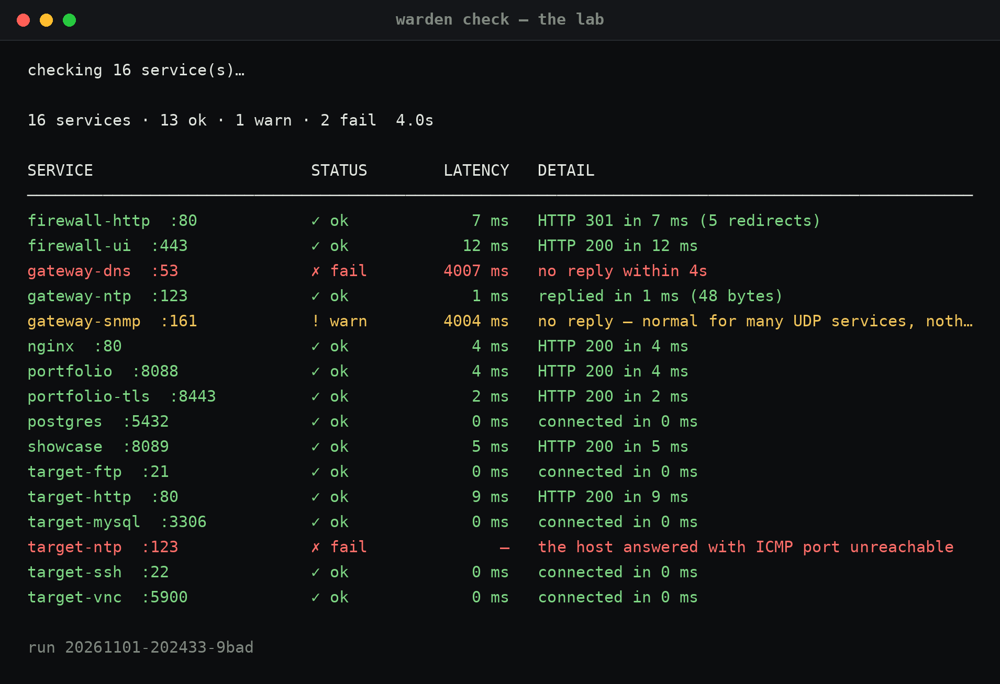
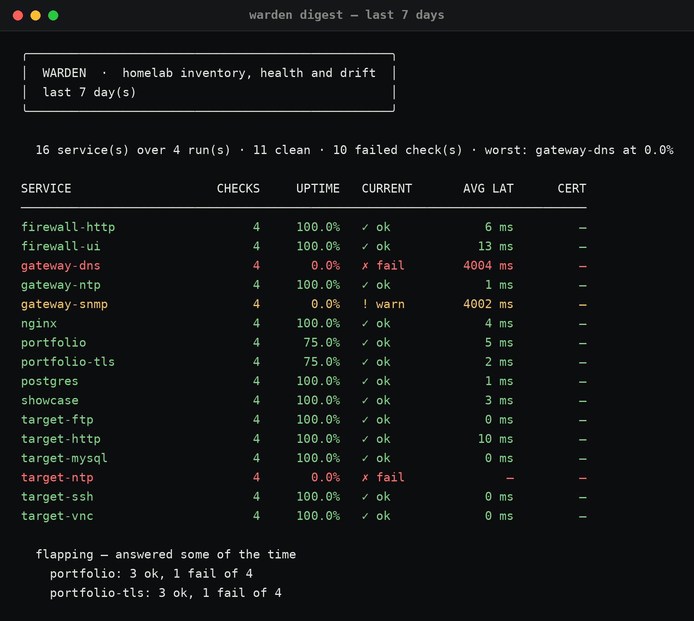

# Warden

**Homelab inventory, health checks and drift detection — one file in, a dashboard out.**

A lab only stays explainable if something is checking it. One TOML file says what is
supposed to be running; Warden connects, records the answer, and tells you what changed
since the last time you looked. I wrote it because I kept forgetting what I had
actually deployed.



```
$ warden check

WARDEN  ·  warden.toml  ·  4/4   0s
━━━━━━━━━━━━━━━━━━━━━━━━━━━━━━━━━━━━━━━━━━━━━━━━━━━━━━━━━━━━━━ 100%
SERVICE                       STATUS        LATENCY   DETAIL
closed-port  :9999            ✗ fail              —   nothing is listening on that port
http-fixture  :8080           ✓ ok             3 ms   HTTP 200 in 3 ms
postgres  :5432               ✓ ok             2 ms   connected in 2 ms
wrong-status  :8080           ✗ fail           2 ms   expected HTTP 418, got 200

4 services · 2 ok · 2 fail  0.0s

  ↓ closed-port: ok → fail  nothing is listening on that port
```

## Why

The recurring homelab question is not "is everything green" — it is **what runs
where, is it up, and what changed since last week**. That answer lives in your head,
a bookmark folder and a markdown table that stopped being true in March.

Warden makes it a file you can version, a history you can query, and a diff you can
read. It is also a machine-readable inventory: an agent or a script can ask
`/api/inventory` instead of guessing.

## What it does not do

- **No credentials.** Nothing logs in to anything.
- **No writes.** A TCP connect, one GET, one TLS handshake.
- **No trust decisions.** Certificate chains are not validated — a lab full of
  self-signed certs would otherwise be permanently red. Use
  [Vantage](https://github.com/Noxwer-beep/vantage) for trust and crypto policy.
- **No agent on the target.** It is a client; hosts need nothing installed.

## Install

Nothing beyond Python 3.11+ (`tomllib` is stdlib) and, optionally, `rich` and
`flask` for the pretty CLI and the dashboard:

```bash
pip install rich flask          # optional, both
git clone <repo> warden && cd warden
./warden.py init                # writes warden.toml
./warden.py check
```

Or `pip install -e .` for a `warden` command on PATH.

## The inventory

`warden.toml` — hosts first, then services that reference them by name.

```toml
[general]
timeout_s = 5
workers = 8
warn_latency_ms = 1200
cert_warn_days = 21

[[host]]
name = "edge"
address = "10.10.10.1"
tags = ["network"]

[[service]]
name = "portfolio"
host = "edge"
port = 443
check = "https"
path = "/"
expect_status = 200
tags = ["web"]
```

### Checks

| `check` | What it does | Extra keys |
|---|---|---|
| `tcp` | Opens and closes a connection | — |
| `http` | `GET`s a path over plain TCP | `path`, `expect_status`, `expect_body` |
| `https` | Same, over TLS; records the certificate | `path`, `expect_status`, `expect_body` |
| `tls` | Handshake only; records expiry and fingerprint | — |
| `udp` | Sends a datagram and waits for a reply | `dns_name`, `payload`, `payload_hex`, `expect_reply`, `expect_body` |

**UDP is honest about what it can prove.** There is no handshake, so silence is not
evidence of failure: a quiet port is reported as `warn`, not `fail`. An ICMP
port-unreachable *is* evidence, and is reported as a failure. Set
`expect_reply = true` when the service is supposed to answer — `dns_name` implies it,
since a resolver that ignores a valid query is down.

```toml
[[service]]
name = "dns"
host = "gateway"
port = 53
check = "udp"
dns_name = "example.com"      # builds a real A query, so the reply means something

[[service]]
name = "ntp"
host = "gateway"
port = 123
check = "udp"
payload_hex = "1b000000..."   # 48-byte NTP client request

[[service]]
name = "snmp"
host = "gateway"
port = 161
check = "udp"
expect_reply = false          # filtered and silent: warn, not a false alarm
```

A service can also pin its own address, for anything that only listens on loopback:

```toml
[[service]]
name = "postgres"
host = "this-box"
port = 5432
check = "tcp"
address = "127.0.0.1"         # the host address would always refuse
```

Parsing is strict on purpose: a service pointing at a host that does not exist is a
refusal, not a silently-unwatched service. Duplicate names, out-of-range ports and
unknown check types are rejected with the reason.

### Statuses

| Status | Meaning |
|---|---|
| `ok` | reachable and behaving as declared |
| `warn` | reachable, but slow, near certificate expiry, or an unexpected-but-tolerable answer |
| `fail` | declared and not reachable — or answering wrong |
| `unknown` | the check itself could not run |

## Commands

```bash
warden init [path]              write a starter inventory
warden check                    run everything, record it, print the result
warden check --only web,db      only services with those tags
warden check --service postgres one service
warden status                   latest recorded state, with uptime
warden drift                    what changed since the previous run
warden digest --days 7          a window of history in one page
warden history <service>        one service's timeline
warden export -o STATUS.md      markdown page for the documentation vault
warden ui                       dashboard on 127.0.0.1:8770
warden doctor                   environment and inventory sanity check
```

Exit codes: `0` all ok · `1` error · `2` inventory problem · `3` missing dependency
· `4` something failed (or `--fail-on warn`).

`--json` on `check`, `status` and `drift` emits machine-readable output and nothing
else on stdout, so it pipes cleanly into `jq`.

## Drift

```
$ warden drift

  2026-11-01 19:58:48 → 2026-11-01 20:14:02   3 unchanged

  ↓ postgres: ok → fail        nothing is listening on that port
  ↑ wrong-status: fail → ok    HTTP 200 in 1 ms
  ⟳ portfolio: sha256:9f2c… → sha256:41ab…   certificate changed since the previous run
```

Four kinds of change, ordered by how much you should care: **worsened**,
**vanished**, **certificate rotated**, **appeared**, **improved**. Ordering is
deliberate — a new certificate is informational, a service that went from ok to fail
is not.

## The weekly digest

A status table answers "is it up now". A digest answers "was it up, and what
wobbled" — which needs history:

```
$ warden digest

  16 service(s) over 4 run(s) · 11 clean · 10 failed check(s) · worst: gateway-dns at 0.0%

SERVICE                    CHECKS     UPTIME   CURRENT       AVG LAT      CERT
──────────────────────────────────────────────────────────────────────────────
gateway-dns                     4       0.0%   ✗ fail        4004 ms         —
gateway-ntp                     4     100.0%   ✓ ok             1 ms         —
portfolio                       4      75.0%   ✓ ok             5 ms         —

  changed during the window
  ↑ portfolio fail → ok  HTTP 200 in 4 ms

  flapping — answered some of the time
    portfolio: 3 ok, 1 fail of 4
```



`--out notes.md` writes the same as markdown for a documentation vault, and
`--json` for anything else. **Flapping** is called out separately: a service that
answers 75% of the time is usually worse than one that is plainly down, because it
never quite gets fixed.

## Dashboard

```bash
warden ui                       # http://127.0.0.1:8770
```

Loopback only, no authentication — it is an operator console, not a service. Service
cards carry status, latency, uptime and certificate days; the drift panel shows the
same diff as the CLI; **Run checks** starts a run in a background thread and the page
polls until it lands.

| Route | Purpose |
|---|---|
| `/` | dashboard |
| `/run` | start a run |
| `/history/<service>` | one service's timeline |
| `/api/status` | latest run + drift, JSON |
| `/api/inventory` | the parsed inventory, JSON |
| `/api/drift` | drift only |
| `/export.md` | the markdown status page |

## Cron

The point of history is that it keeps itself. A nightly run plus an export gives you
a status page that is true:

```cron
15 3 * * *  cd ~/warden && ./warden.py check --quiet >/dev/null 2>&1
20 3 * * *  cd ~/warden && ./warden.py export -o ~/Obsidian/Engineering/Homelab/status.md
```

Use `--fail-on fail` (the default) and let the exit code drive your alerting.

## Tests

```bash
python3 -m unittest discover -s tests -t .
```

102 tests, stdlib only, no mocking: the prober tests bind real sockets and speak real
HTTP/TLS to 127.0.0.1. Storage, drift and inventory parsing are covered for the
failure cases, because those are the ones that matter.

## Design notes

- **One file is the source of truth.** No database of "services" to drift from the
  thing you actually maintain.
- **The check is not allowed to crash the run.** Every probe is wrapped; an
  unexpected exception becomes `unknown`, never a stack trace mid-table.
- **Availability ≠ trust.** Stated in the UI footer and in every export, because a
  green dashboard that quietly passed an expired certificate would be worse than none.
- **History is cheap.** SQLite in `~/.local/share/warden/warden.db`; `prune()` keeps
  the last N runs.

## Licence

MIT.
